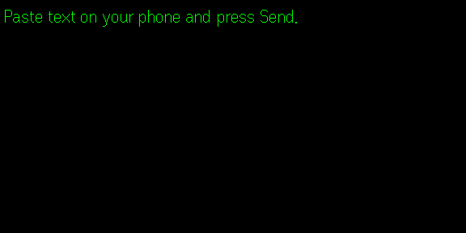

# PL PROMPTER

A teleprompter for the Even Realities G2 glasses, built as an Even Hub app. Paste a
script on the phone, read it on the lenses, page through it with a swipe.



*The lens before any text is sent, captured from the Even Hub simulator.*

## Features

- **Three reading modes** over the same text:
  - **Scroll** wraps long copy into pages.
  - **Cards** splits on blank lines, one idea per screen.
  - **Cues** steps one line at a time with an `n / total` count, and holds at the first
    and last line rather than wrapping past them.
- **Real text size.** The G2 firmware has no font-size control, so sizes above the
  firmware default are rasterised with [Glyph](https://www.npmjs.com/package/@gabrielevierti/glyph)
  and sent as image tiles. The size ladder is 0 (firmware text, fastest page turn),
  22, 28, 36, 46, 58 and 72 px.
- **Firmware-text legibility levers** for size 0: ALL CAPS, line width, lines per page,
  and a zone that parks text at the top, middle, bottom or full lens.
- **Two presets:** the Three Truths (Cards mode) and a random line from the Psyched
  Luxuries seed library (Scroll mode).
- **Settings persist** on the device through the SDK's local storage.
- **Offline.** `app.json` requests no permissions and the app makes no network calls.

## Controls

| Input | Action |
|---|---|
| Swipe down | next page, card or cue |
| Swipe up | previous page, card or cue |
| Double press | exit (system confirm dialog) |
| Tap, then long press | menu: Restart, Next mode, Bigger, Smaller, New seed |
| Phone | mode, size, width, lines, caps, zone, presets, Send to glasses, live lens preview |

## Requirements

- Even Realities G2 glasses and the Even Realities app (`app.json` sets minimum app version 2.2.9)
- Node.js and npm for development
- Even Hub SDK 0.0.14 or later

## Run it

```bash
npm install
npm run dev          # Vite dev server on http://localhost:5173
```

Open it on the glasses with `npx evenhub qr --url http://<your-lan-ip>:5173`, or in the
desktop simulator with `npx evenhub-simulator -g http://localhost:5173`.

Test entry points: `?autotest=<url-encoded text>` sends that text directly (optional
`&mode=scroll|cards|cues` and `&size=<px>`), and `?preset=truths` loads the Three Truths.

## Build and package

```bash
npm run build                          # tsc && vite build, into dist/
npx evenhub pack app.json dist -o pl-prompter.ehpk
```

`scripts/capture-store-shots.py` captures lens frames from the simulator's automation
port (needs Python and Pillow). The automation API drives glasses input only, not the
phone WebView, so it cannot enter text on its own.

## Project structure

```
src/
  main.ts             modes, pagination, menu, input handling, phone UI
  glyph-screen.ts     Glyph rasteriser to 4 image tiles of 288 x 144
  keyboard-scroll.ts  keeps the phone page scrollable after the iOS keyboard closes
  seeds.json          the seed library behind the "A Seed" preset
store-assets/         simulator captures
STORE-LISTING.md      Even Hub store submission notes
app.json              Even Hub app definition
```

## License

All rights reserved. Public to read; no licence is granted to copy, modify or
redistribute. See [LICENSE](LICENSE).

Made by [Psyched Luxuries](https://psychedluxuries.com).
